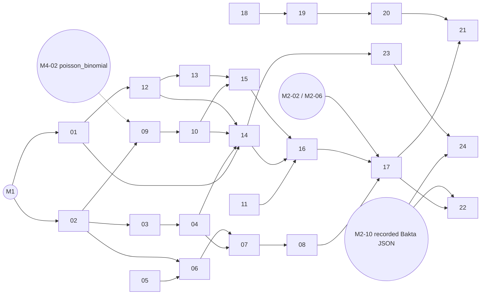

# M3 "Mapping and decoy FDR": issue index

Spec: GIAP_SPEC.md §13 row M3. Deliverables: "six-frame index, exact matching, miniprot and
tblastn, tolerant matcher, decoys, placement FDR, loci, contaminants, Module 2 outputs;
`giap makedb`; **pilot kit (§15) prepared**, and Khoa asked to install DIA-NN". **Gate:** "≥ 99.9 %
recall of planted peptides; mapping FDR calibrated; TE1 and TE8 proxies pass".
Sections used: §7.2 (all), §7.9.2, §8.1–8.5, §9.3–9.4, §11.2–11.3, §11.6 (TE1, TE5, TE8), §15,
Appendix B.2, B.5, B.6; decisions 5, 6, 13, 16, 20; G3, G4.

One issue = one PR. Estimates are **code** lines under `src/`, `workflow/`, `scripts/` (ADR-0007:
only these count toward the 400/800 gate); simulator issues live in `tests/sim/` and are kept
under 400 anyway. Tests are not counted.

| Order | Issue | Scope | Depends on | Ext. tools | Est. |
|---|---|---|---|---|---|
| 1 | [M3-01](M3-01-gene-model.md) | `model/genes.py`: `GeneModel` interface + minimal Bakta-like JSON reader | M1 | – | 230 |
| 2 | [M3-02](M3-02-sixframe-index.md) | six-frame translation (numba), I→L codes, circular 120-nt wrap, frame ↔ interval map, `frame` label | M1 | – | 320 |
| 3 | [M3-03](M3-03-decoy-translations.md) | reverse / windowed shuffle decoys, mirror map, `.npz` index work file | 02 | – | 220 |
| 4 | [M3-04](M3-04-exact-matcher.md) | Route 1: Aho–Corasick exact matching, target + decoy; shared hit schema | 02, 03 | – | 260 |
| 5 | [M3-05](M3-05-masses-and-diff-ops.md) | B.5 masses, generated mass-equivalence list, §7.2.4 operation tables | – | – | 200 |
| 6 | [M3-06](M3-06-tolerant-verifier.md) | banded DP verifier (±2) with the five cost-1 operations (numba) | 02, 05 | – | 300 |
| 7 | [M3-07](M3-07-tolerant-seeds.md) | q-gram index, lossless threshold, diagonal bands, target/decoy tolerant driver | 02, 03, 04, 06 | – | 380 |
| 8 | [M3-08](M3-08-frameshift-splits.md) | ±1-nt frameshift splits, decoys by mirrored adjacency | 02, 03, 06, 07 | – | 260 |
| 9 | [M3-09](M3-09-chance-hit-model.md) | E(L, m); ranking score E_i; B.2 Monte Carlo (`stats/poisson_binomial.py` shared with M4-02) | 02 (M4-02) | – | 160 |
| 10 | [M3-10](M3-10-placement-fdr.md) | placement FDR (G3): strata, π̂_wrong, q-values, `same_db`, `mapping_fdr` rows | 09 | – | 330 |
| 11 | [M3-11](M3-11-denovo-precision.md) | de novo precision per score bin, bootstrap CI, π̂ for de novo | – (synthetic inputs) | – | 220 |
| 12 | [M3-12](M3-12-miniprot-route.md) | miniprot commands, GFF parser, CDS assignment, similarity class | 01 | **miniprot 0.18** | 300 |
| 13 | [M3-13](M3-13-tblastn-route.md) | tblastn leftovers, collinear HSP merge (origin-aware) | 12 | **BLAST+** | 260 |
| 14 | [M3-14](M3-14-loci-and-assignment.md) | locus classes, uniqueness, peptide/protein → gene, genome relation, flags | 01, 02, 04, 10, 12 | – | 380 |
| 15 | [M3-15](M3-15-contaminants-unmapped.md) | unmapped bucket, reasons, contaminant library (peptides AC; proteins blastp) | 10, 12, 13 | **BLAST+ blastp** | 250 |
| 16 | [M3-16](M3-16-mapping-outputs.md) | the seven Module 2 outputs + Frictionless table schemas | 10, 11, 14, 15 | – | 360 |
| 17 | [M3-17](M3-17-mapping-steps.md) | query selection, step functions, `mapping.nf`, local executor, golden | 01–16, M2-02, M2-06 | via 12, 13, 15 | 330 |
| 18 | [M3-18](M3-18-sim-genome-features.md) | giapsim: sORFs, pseudogenes, rRNA/tRNA, N-term ext., novel ORFs, plasmids, linear contig, origin gene, strain differences | M0 sim | – | (380 sim) |
| 19 | [M3-19](M3-19-sim-peptides-db-errors.md) | giapsim: digest, detectability, intensities, π_wrong errors, score mixture → q/PEP, decoy rows, proteins.faa | 18 | – | (360 sim) |
| 20 | [M3-20](M3-20-sim-denovo-errors.md) | giapsim: de novo error model, known precision per bin, reference peptides | 19 | – | (300 sim) |
| 21 | [M3-21](M3-21-calibration-and-gate.md) | placement/de novo calibration suites, attack 5, recall gate, golden tables, nightly array | 17, 19, 20 | – | 80 |
| 22 | [M3-22](M3-22-digest-and-te-proxies.md) | `mapping/digest.py`; TE1 proxy (Nissle Bakta), TE8 proxy (UniProt K-12, weekly) | 17; M2-10 recorded Bakta JSON | network (FarmShare) | 260 |
| 23 | [M3-23](M3-23-makedb.md) | `giap makedb`: strain DB, six-frame ORFs, id_map, manifest | 01, 02, 14 | – | 330 |
| 24 | [M3-24](M3-24-pilot-kit.md) | pilot kit: DIA-NN cfgs, sbatch scripts, A2 DB, Khoa's DIA-NN install request | 23; M2-10 recorded Bakta JSON | DIA-NN, Cascadia (prepared, not run) | 250 |

Total ≈ 5,700 code lines in `src/`/`workflow/`/`scripts/` plus ≈ 1,000 simulator lines.

## Dependency DAG

Critical path: 02 → 03 → 04 → 07 → 08 → 17 → 21 (with 05 → 06 feeding 07).

## Parallel tracks

After M3-01 and M3-02 (both start on day one, independently), up to seven sessions can work at
once; each track touches its own files.

| Track | Issues | Kind | Needs |
|---|---|---|---|
| **A. Index and exact matcher** | 02 → 03 → 04 | pure Python + numba | – |
| **B. Tolerant matcher** | 05 → 06 → 07 → 08 | pure Python + numba (hot loops) | 05 and 06 can start before A finishes (06 needs only 02's codes); 07 needs 03/04 |
| **C. Placement-FDR statistics** | 09 → 10; 11 | pure functions, synthetic inputs; statistician reviews | methods notes first (below) |
| **D. Simulator extensions** | 18 → 19 → 20 | `tests/sim/` tooling | none from `src/` beyond M3-01 for validation |
| **E. Protein routes** | 12 → 13 (→ blastp in 15) | **external**: miniprot 0.18, BLAST+ via conda (`workflow/envs/*.yml`) or Apptainer; envs built with `sbatch scripts/slurm/build_envs.sbatch`, recorded outputs on FarmShare | 01 |
| **F. Annotation joins and outputs** | 01 → 14 → 15 → 16 | pure Python (15 calls blastp) | 10 and 12 for real inputs; can start on hand-made hit tables |
| **G. makedb and pilot kit** | 23 → 24 | pure Python + sbatch scripts; DIA-NN/Cascadia only prepared | 01, 02, 14; recorded Nissle Bakta JSON (M2) |
| Integration | 17 → 21, 22 | everything joins | all tracks; M2 step registry |

Pure Python (no external tool): 01–11, 14, 16, 18–21, 23. External: 12 (miniprot), 13 and 15
(BLAST+), 22 (UniProt over the network, FarmShare only), 24 (DIA-NN, Cascadia — scripts only).
Never install packages from a subagent; tool environments come from `workflow/envs/*.yml` built in
a Slurm job.

## Gene model: the interface M3 consumes

M3-01 defines `giap.model.genes.GeneModel` (`replicons`, `genes: Gene` with locus tag, type
{cds, sorf, pseudogene}, interval, `aa`, `nt`, start codon, partial; `features: NcFeature` for
rRNA/tRNA/ncRNA/…; `overlapping(iv)`). The full Bakta parser is **M2-03**
(`parse_bakta_json`, which extends the same `giap.model.genes` module with defaulted fields) and
**M2-04** (`parse_bakta` step → `genes.parquet`, `features.parquet`). Until they land, M3 reads
the simulator's Bakta-like JSON through `gene_model_from_bakta_json`, so no M3 issue waits for
M2. M3-01 and M2-03 share one file: give them to one agent or merge M3-01 first (M2-index says
the same). Other M2 touch points: M2-02 step registry and M2-06 Nextflow skeleton (M3-17 only);
M2-01 `workflow/envs/miniprot.yml` / `blast.yml` (M3-12/13/15; created by M3 if M2-01 is late);
M2-09 `giap setup --contaminants` → `contaminants/contaminants.fasta` (M3-15; tests use a
fixture); M2-10 recorded full-DB Bakta JSON for Nissle and K-12 (M3-22, M3-24); M3-18 must merge
before M2-05 (simulator v2 builds on it).

**Downstream contract.** M4-06 (C11–C13) reads M3-16's final `mapping/*.tsv` (no Parquet twin
needed) and relies on: decoys never in `peptide_hits.tsv`, `gene` set exactly for assigning
classes, every `gene` a locus tag of the gene model. `poisson_binomial_*` is shared with M4-02
(`stats/poisson_binomial.py`), and M3-10 reuses M4-01's `tda_qvalues` for constant π̂.

## Statistical issues and methods notes (§14.1, §14.9)

| Methods note (statistician signs off before the code PR merges) | Issues |
|---|---|
| `docs/methods/placement-fdr.md` — sections: Genome decoys; Chance hits and the ranking score; Strata and ranking; π̂_wrong; Same-strain input; Calibration (incl. attack 5) | M3-03, M3-09, M3-10, M3-21 |
| `docs/methods/denovo-precision.md` — estimator, bins, bootstrap, reportability, how π̂ feeds placement | M3-11, M3-21 |

Calibration (§8.4, `tests/calibration/tolerances.yaml`): statistics-only suites ship with M3-09
(B.2 Monte Carlo within 20 %), M3-10 (FDR ≤ q + 2 SE on exchangeable lists) and M3-11 (|bias| ≤
0.05); genome-level suites with giapsim (R = 50 @ 100 kb per PR, R = 300 @ 1 Mb nightly) and the
gate are M3-21. Hypothesis properties of §11.2 owned by M3: "a peptide cut from a random genome
maps back to its origin" (M3-04), "reverse complement swaps the strand" (M3-02, M3-08), "tolerant
matcher = brute force" (M3-06, M3-07, M3-08; zero false negatives per difference type), "decoy
translations keep composition" (M3-03).

## Decisions taken in these specs (for the lead to confirm)

- `frame` column = ±1..3, phase relative to each strand's 5′ end of the replicon (M3-02 Q1).
- `diff_types` vocabulary {substitution, swap, block, near_block, frameshift} (M3-05 Q1).
- Decoys are searched for **every** mapped peptide (exact for all, tolerant for all ≥ 10 aa);
  target tolerant search only for exact leftovers (M3-10 Q1).
- De novo π̂ enters FDR₀(e) as the mean π̂ of targets with E ≤ e (M3-10 Q2).
- Only non-decoy peptides with q ≤ `input.q_value_max` (or no q) are mapped (M3-17 Q2).
- `multi` becomes a placement flag (M3-14 Q1); repeats inside one gene are `unique` (M3-14 Q2).
- Pseudogene placements assign to the pseudogene (M3-14 Q3, aligned with M4-06 Q3; the spec's
  §7.2.6 list names only `cds_inframe`/`sorf`, so the lead must confirm).
- `too_short` = no exact hit and shorter than the tolerant minimum (M3-15 Q2).
- New config keys `mapping.proteins.hsp_max_gap_nt: 300`, `hsp_max_q_overlap_aa: 10` (ADR,
  additive; M3-13 Q1); BLAST+ version pinned at env build (M3-13 Q2).
- GFF3 type `nucleotide_to_protein_match`; proBed `fdr` = `placement_q` (M3-16 Q1–Q2).
- Strain-difference sims: `genome.fasta` = sample, `reference.fasta` = related genome (M3-18 Q1).
- `nterm_extension` makedb entries = upstream part + first 30 aa (M3-23 Q1); A2 built with
  `--no-contaminants` (M3-23 Q2, M3-24).

The most consequential for statistics are M3-10 Q1–Q2 and M3-11 Q1; they go to the statistician
with the methods note.

## Lead decisions on the questions (2026-10-14)
1. M3-10 Q1: decoys searched for every mapped peptide; tolerant target search only for peptides without
   an exact hit. Accepted.
2. M3-10 Q2: per-bin de novo π̂ enters FDR₀(e) as the mean π̂ of targets with E ≤ e. Accepted; the
   statistician signs it off in docs/methods/placement-fdr.md.
3. M3-14 Q3: placements on pseudogenes are assigned to the pseudogene (matches M4-06 Q3; beyond the
   §7.2.6 list). Accepted; recorded in the methods note.
4. M3-17 Q2: map only non-decoy peptides with q ≤ `input.q_value_max`. Accepted provisionally — the
   statistician must confirm that gene-level FDR (M4, §7.3.2) does not need placements of rows above
   the cut-off ("still used to estimate FDR", §5.2) before M3-17 merges.
5. M3-02 Q1, M3-05 Q1: `frame` convention and `diff_types` as proposed. Accepted.
6. M3-14 Q1: `multi` as a new placement flag (added to the §9.4 vocabulary via the schema). Accepted.
7. M3-11 Q1: drop unreportable length classes within a bin and renormalise. Accepted.
8. M3-13: HSP-chaining parameters would be new thresholds/config keys → **Khoa's call** (he declined
   new thresholds on 2026-10-14); asked when M3-13 starts. Until then M3-13 does not merge.
9. M3-23 Q1: `nterm_extension` entry shape as proposed. Accepted.
10. M3-24: the A2 database is built with `--no-contaminants`, because the DIA-NN template already adds
    `contaminants.fasta` (§15.2) and duplicates would split protein groups. Accepted.
